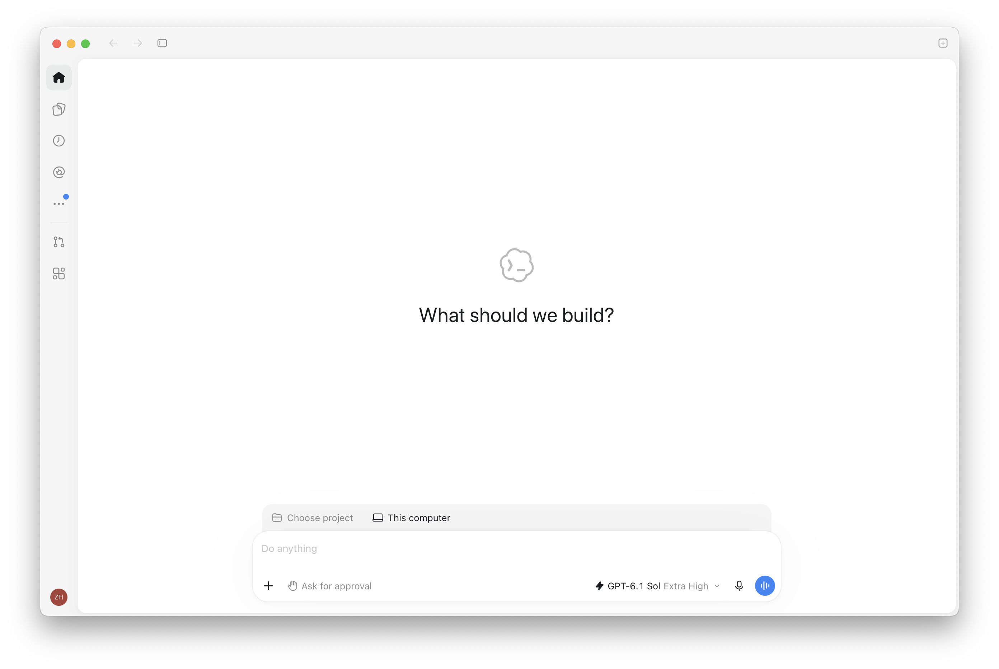
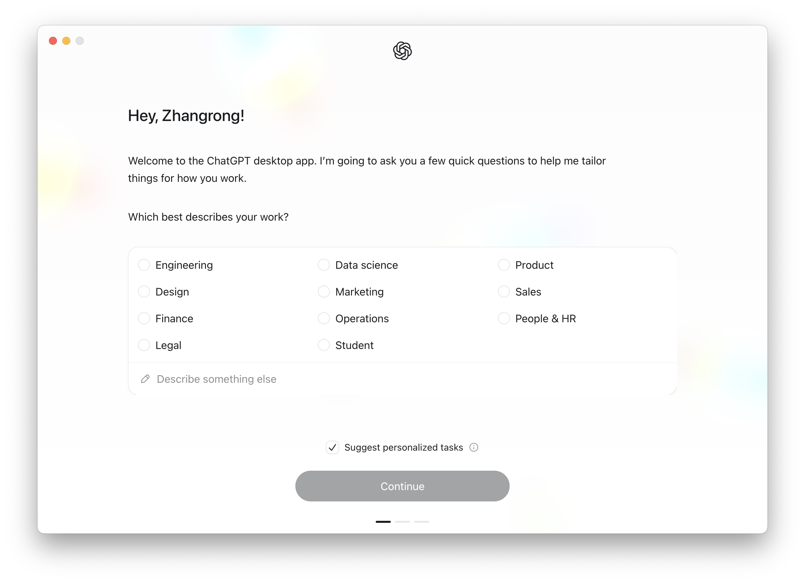
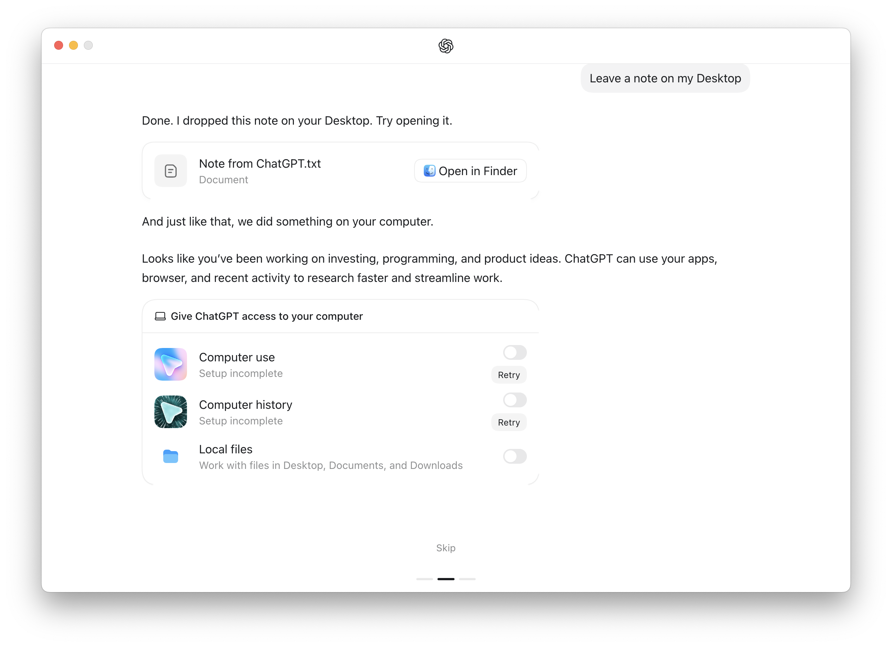

# Codex Intel

**在 Intel 芯片的 Mac 上，本地构建一个能够运行 Codex 桌面界面的兼容版本。**

如果你的 Mac 使用 Intel 处理器，官方桌面安装包却要求 Apple Silicon，这个项目提供了一条已经在 Intel Mac 上验证过的路径：获取官方应用，换用 Intel 运行时和编码后端，重新编译必要的模块，生成 `Codex Intel.app`。

这是一个**非官方、实验性的兼容构建工具**，与 OpenAI 没有隶属关系。截至 2026-10-20，[官方 macOS 桌面下载](https://learn.chatgpt.com/docs/app)仍标注为 Apple Silicon。我们已验证界面启动和编码后端的实际文件读写；部分桌面原生能力尚未适配，详见[功能状态](#功能状态与限制)。

仓库提供构建脚本、兼容层和验证工具。**目前需要在自己的 Intel Mac 上构建，没有提供预编译安装包。** 首次安装需要使用终端，下面会逐步说明。

## 实际效果

以下为 Intel Mac 上运行的真实截图。界面中的模型与功能入口由上游版本和账号决定；出现入口并不代表对应功能已经通过兼容性验证。



<details>
<summary>查看首次启动引导截图</summary>





第二张引导图中的 Computer use 和 Computer history 显示为尚未完成设置，这两项不在当前已验证范围内。

</details>

## 它是怎么工作的？

桌面应用里既有界面代码，也有与处理器架构相关的运行时和原生模块。本项目保留官方界面，在本机完成以下适配：

1. 从官方更新源下载应用，校验 OpenAI 的 Apple 开发者签名，以及更新包的 Ed25519 签名。
2. 读取应用需要的 Electron 版本，下载对应的 macOS x64 运行时。
3. 为 Intel 重建数据库、终端等原生模块，选用可加载的 Objective-C 桥接。
4. 使用本机已经安装的 Intel Codex CLI 编码后端，加入必要的兼容接口。
5. 生成独立的 `Codex Intel.app`，进行本地 ad-hoc 签名，并记录构建信息。

这是针对该桌面应用的兼容适配，不提供通用的 ARM 指令转译能力。模型仍通过网络调用，运行应用仍需要自己的账号与相应的服务使用权限。

## 功能状态与限制

| 项目 | 当前状态 |
| --- | --- |
| Intel 原生运行时 | 已验证 x64 Electron，以及构建产物中的 Mach-O 二进制架构 |
| 桌面界面 | 已验证启动与页面渲染；首次引导需自行完成 |
| Codex 后端 | 已验证初始化、读取已有登录状态、获取模型目录 |
| 实际编码任务 | 已通过打包后的后端，调用模型在临时目录创建并读取文件 |
| SQLite 数据库 | 已验证实际查询 |
| 伪终端 | 已验证创建终端并执行命令 |
| Objective-C 桥接 | 已验证原生模块加载 |
| 任务管理器、语言、部分窗口接口 | 已提供兼容实现或明确的能力查询结果 |
| 内置浏览器的 Owl 原生集成 | 尚未完整适配；部分接口只保留回调注册，没有对应的原生事件 |
| 网站活动记录 | 不支持，保持关闭 |
| 部分系统快捷键、Work Louder 外设 | 尚未适配 |
| 电脑控制、语音、其他高级功能 | 尚未验证 |
| 官方自动更新 | 已关闭；升级需要重新获取来源并构建 |

编码验证直接覆盖打包后的后端，不等于所有界面操作、插件和桌面功能都已经通过端到端测试。可在 App 的“帮助”菜单中查看 Intel 兼容性说明。

### 已验证的版本组合

以下是一次通过验证的组合，不代表脚本会把所有组件固定为这些版本：

| 组件 | 已验证版本 |
| --- | --- |
| 系统 | macOS 15.7.3，Intel x86_64 |
| 官方应用来源 | 26.1013.40934，2026-10-16 发布 |
| Electron | 42.3.0，macOS x64 |
| Codex 编码后端 | 0.163.0，macOS x86_64 |
| Node.js / Python | 25.9.0 / 3.14.3 |

当前官方来源的安装包名称为 `ChatGPT.app`，内部应用标识仍为 `openai-codex-electron`，其中包含 Codex 界面。因此首次打开可能显示 ChatGPT 的引导页面。

`fetch-latest.py` 默认获取官方更新源中的最新版本；官方后续更新可能引入新的依赖，最新版本不一定已经经过本项目验证。

## 开始之前

需要准备：

- 一台 Intel Mac。已实测 macOS 15.7.3，其他系统版本尚未验证。
- Python **3.11 或以上**。
- Node.js **22.12 或以上**，以及随 Node.js 安装的 npm。
- Git、ripgrep，以及 Apple 的 Xcode Command Line Tools。
- 已安装的 **Intel 版本 Codex CLI**，并完成自己的账号登录。
- 能连接官方应用下载源、npm、Electron 下载源和 OpenAI 服务的网络。

首次构建会下载数百 MB 的官方安装包、Electron 和依赖，并占用数 GB 磁盘空间。耗时主要取决于网络与原生模块编译速度；后续会复用本地缓存。

### 1. 确认你的 Mac 是 Intel

打开“终端”：可以按 `Command + 空格`，搜索“终端”。运行：

```sh
uname -m
```

输出应该为 `x86_64`。如果是 `arm64`，建议直接使用官方 Apple Silicon 版本。

### 2. 安装编译工具和基础依赖

安装 Apple 命令行开发工具：

```sh
xcode-select --install
```

如果系统提示已经安装，可以继续。

如果你已安装 [Homebrew](https://brew.sh/)，可以用它安装依赖：

```sh
brew install node python git ripgrep
```

没有 Homebrew 也可以分别安装 [Node.js](https://nodejs.org/en/download)、[Python](https://www.python.org/downloads/macos/) 和 [ripgrep](https://github.com/BurntSushi/ripgrep#installation)。选择适用于 Intel / x64 的版本，或包含 Intel 架构的 universal 版本。

安装后关闭终端并重新打开，检查：

```sh
node --version
npm --version
python3 --version
git --version
rg --version
xcode-select -p
```

确认 Node.js 和 Python 满足上面的最低版本。系统自带的旧版 Python 可能不满足要求。

### 3. 安装 Codex CLI，并登录

本项目采用 npm 安装的 CLI 路径作为常见来源之一：

```sh
npm install -g @openai/codex
codex --version
codex login
```

按终端和浏览器提示完成自己的账号登录。已有可用 CLI 和登录状态时，无需重复登录。[官方 CLI 文档](https://learn.chatgpt.com/docs/cli)介绍了安装和账号使用方式。

应用和模型的使用权限取决于你的账号与服务配置。本项目不提供账号、API Key 或额外额度。

### 4. 下载本项目

下面使用 HTTPS 克隆，不需要先配置 GitHub SSH 密钥：

```sh
mkdir -p ~/Code
cd ~/Code
git clone https://github.com/ZR-Huang/Codex-Intel.git
cd Codex-Intel
```

后续命令都在这个仓库目录中运行。也可以在 GitHub 点击 **Code → Download ZIP**，解压后在终端进入该目录。

### 5. 下载并验证官方应用来源

```sh
python3 fetch-latest.py
```

脚本会从官方更新源下载应用，并检查：

- 下载长度是否与更新源声明一致。
- 应用的完整 Apple 代码签名，以及 OpenAI 的开发者团队身份。
- 更新包的 Ed25519 签名。验证所需的公开密钥从已通过 Apple 签名验证的原始应用读取，以支持官方密钥轮换。

验证通过后才会把该来源登记为后续构建的默认来源。这里验证的是下载的原始应用；本地兼容产物会重新进行 ad-hoc 签名，不继承 OpenAI 的官方签名或公证。

### 6. 构建 Intel 应用

先查看即将使用的版本和后端：

```sh
python3 convert.py --inspect
```

然后构建：

```sh
python3 convert.py
```

看到 `Built:` 后，生成的应用位于：

```text
dist/Codex Intel.app
```

也可以双击 `build.command` 来构建已经准备好的来源。

构建器会自动寻找本机的 Intel CLI 和已安装的 Codex 后台服务版本，优先使用版本较新的可用后端。它不会替换 `/Applications` 中已有的官方应用。

### 7. 打开并使用

```sh
open "dist/Codex Intel.app"
```

或者在 Finder 中双击仓库里的 **打开Codex Intel.command**。

首次打开可能需要完成官方引导、登录或选择工作目录。进入 Codex 后，选择一个测试项目，发送一个简单任务，例如：“请解释这个项目的目录结构”。

开始修改重要项目之前，建议先用 Git 保存现有工作。按任务需要选择应用提供的权限设置。

## 数据存在哪里？

| 内容 | 默认位置 |
| --- | --- |
| 官方下载包、验证来源、构建依赖 | 本仓库的 `.cache/` |
| 生成的 App、构建报告和测试输出 | 本仓库的 `dist/` |
| 兼容版的界面设置 | `~/Library/Application Support/Codex Intel` |
| Codex 登录、配置和会话 | 由官方 CLI / 后台服务管理，通常位于 `~/.codex/` |

构建脚本复制的是可执行后端，不会把你的登录文件、私钥或 Token 打包进应用。运行后的官方应用和后端仍会按正常流程使用本机账号，并与相关服务联网；这不是离线模型。

`.cache/`、`dist/`、日志、原始截图和常见凭据文件已列入 `.gitignore`。构建报告可能含本机绝对路径，测试截图和日志也可能含账号内容，分享前需要单独检查，避免上传这些本地输出。

## 如何升级？

先退出正在运行的 Codex Intel，再更新本项目、CLI 和官方来源：

```sh
git pull --ff-only
npm install -g @openai/codex
python3 fetch-latest.py
```

构建器不会覆盖已经存在的 App。可以为新版本指定一个新位置，保留旧版方便回退：

```sh
python3 convert.py --output "dist/Codex Intel New.app"
open "dist/Codex Intel New.app"
```

确认新版可用后，再自行整理旧版。默认启动脚本仍打开 `dist/Codex Intel.app`，不会自动切换到自定义输出位置。

官方自动更新在兼容版中关闭，以避免下载的 ARM 安装包覆盖 Intel 版本。未来官方更新也可能需要增加新的兼容实现。

## 常见问题

### 下载很慢、连接超时

如果本机配置的代理连接官方 CDN 较慢，可以只对官方 CDN 尝试直连：

```sh
python3 fetch-latest.py --direct --workers 8
```

该选项不会修改系统或全局代理。`--workers` 可设为 1 到 12；网络不稳定时可以降低并发，再运行同一命令，脚本会复用长度正确的已下载分块。

如果慢在 Electron 下载，参见 [Electron 官方安装说明](https://www.electronjs.org/docs/latest/tutorial/installation)。确有需要时，可以为单次构建指定第三方下载镜像。例如，**仅当 `--inspect` 显示 Electron 为 42.3.0 时**：

```sh
ELECTRON_MIRROR=https://npmmirror.com/mirrors/electron/ \
ELECTRON_CUSTOM_DIR=42.3.0 \
python3 convert.py
```

其他版本需要修改 `ELECTRON_CUSTOM_DIR`。镜像由第三方提供，下载仍由 Electron 安装器按 npm 包提供的校验值检查。

### 提示找不到 Intel Codex binary

先确认 `codex --version` 能正常运行。通过 npm 安装时，构建器会寻找包内的 Intel 原生后端，而不是直接复制 JavaScript 启动脚本。

使用非标准安装位置时，可以指定原生可执行文件：

```sh
python3 convert.py --codex "/path/to/intel/codex"
```

这里的 `/path/to/intel/codex` 是占位路径，需替换成你自己的 Intel Mach-O 后端文件。

### 提示输出 App 已经存在

为新版本指定另一个 `--output`，或者在退出应用后通过 Finder 将旧产物改名。构建器会保留已经存在的 App。

### macOS 拦截打开

本地构建使用 ad-hoc 签名，没有 OpenAI 的发行签名或公证。如果 macOS 提示无法验证开发者，请先确认应用确实由自己从本仓库构建，再按系统提供的打开方式处理。不要用来历不明的他人打包文件替代本机构建。

### 界面提示 Update required

官方服务可能已经停用较旧的客户端。重新获取官方来源并构建到新的输出目录。不能通过仅替换版本号解决协议或功能不兼容。

### 部分功能按钮可见，但是无法使用

界面保留了上游功能入口。Owl 原生浏览器集成、网站活动记录、部分快捷键和外设尚未完整适配；电脑控制、语音也尚未验证。先查看本文的[功能状态](#功能状态与限制)，再附上具体错误反馈。

### 能使用已有的官方应用作为来源吗？

可以指定来源：

```sh
python3 convert.py --source "/path/to/ChatGPT.app" --inspect
python3 convert.py --source "/path/to/ChatGPT.app" --output "dist/Codex Intel Custom.app"
```

`--source` 指定本机应用时，`convert.py` 不会替你执行 `fetch-latest.py` 的来源签名校验，应自行确认来源可信且版本仍可用。未准备默认下载来源时，构建器会尝试 `/Applications/Codex.app`；建议优先使用下载并验证过的最新来源。

## 验证构建结果

以下测试为可选步骤，正常打开应用不要求先运行它们。

### 基础检查

```sh
node smoke-test.mjs
```

会执行 SQLite 查询、启动伪终端、加载 Objective-C 桥接、初始化后端、读取登录状态和模型目录，并启动界面保存截图。它不主动发起模型推理请求，但会连接服务；界面使用临时设置目录，不替你填写首次引导。

默认检查 `dist/Codex Intel.app`，也支持自定义产物：

```sh
node smoke-test.mjs "dist/Codex Intel New.app"
```

结果写入 `dist/smoke-report.json`，界面截图写入 `dist/smoke-screen.png`。

### 实际编码检查

```sh
node coding-e2e.mjs
```

此项检查默认位置的 `dist/Codex Intel.app`，会**发起一次真实模型任务，使用你的账号额度，并可能产生费用**。测试在临时工作目录中创建、读取一个文件并校验内容，完成后清理临时目录。不会向原有项目写入文件。

结果写入 `dist/coding-e2e-report.json`。

## 文件说明

| 文件 | 用途 |
| --- | --- |
| `fetch-latest.py` | 下载并验证官方应用来源 |
| `convert.py` | 检查来源、准备 Intel 依赖、重建模块、生成并签名 App |
| `intel-compat.cjs` | 补充上游依赖的部分 Electron 接口，提供兼容性说明 |
| `app-server-client.cjs` | 验证工具使用的 Codex App Server JSON-RPC 客户端 |
| `smoke-test.mjs` | 原生模块、后端、界面基础检查 |
| `coding-e2e.mjs` | 真实模型的文件创建与读取检查 |
| `build.command` | Finder / 终端构建入口 |
| `打开Codex Intel.command` | Finder 启动入口；没有默认产物时尝试构建 |
| `使用说明.txt` | 简要离线使用说明 |
| `img/` | README 使用的已审查截图 |

`--dev-compat` 仅用于调试：它让产物引用当前仓库的兼容模块。正常构建将兼容模块封装在 App 内，使用时不依赖源码目录。

## 反馈与贡献

欢迎通过 [Issues](https://github.com/ZR-Huang/Codex-Intel/issues) 反馈兼容性问题，或提交改进文档、脚本和原生接口适配的 Pull Request。

反馈时请提供 macOS 版本、Intel 机型、官方来源版本、Electron 版本和错误发生的步骤。分享日志、`--inspect` 输出或截图之前，请移除姓名、邮箱、本机用户名、项目路径、对话内容，以及任何 Key、Token 和登录信息。

不要提交官方安装包、构建产物、账号文件、原始私人截图或第三方专有应用代码。

## 许可证与来源

本仓库原创构建脚本、兼容层及验证工具采用 [MIT License](LICENSE)。该许可证不改变官方应用、Electron、Codex CLI 或其他第三方组件各自的许可条款。官方应用和依赖由用户在本机获取，不随本仓库分发；截图中的第三方界面与商标属于各自权利人。

技术参考：[官方桌面应用](https://learn.chatgpt.com/docs/app)、[Codex CLI](https://learn.chatgpt.com/docs/cli)、[Codex App Server](https://learn.chatgpt.com/docs/app-server)、[Electron 原生模块](https://www.electronjs.org/docs/latest/tutorial/using-native-node-modules)。
